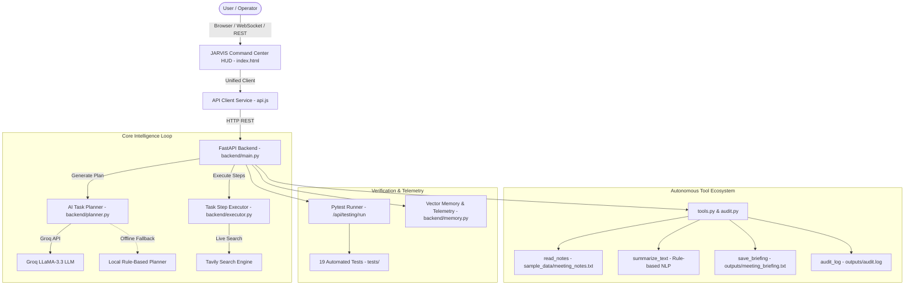

# 🤖 JARVIS — Autonomous Personal AI Agent & Command Center

[](https://python.org)
[](https://fastapi.tiangolo.com)
[-brightgreen?style=for-the-badge&logo=pytest&logoColor=white)](https://pytest.org)
[](https://groq.com)
[](LICENSE)

> An end-to-end autonomous personal agent built for hackathon demonstration. Features a futuristic glassmorphic Command Center HUD, autonomous multi-step task planning, live web intelligence, non-repudiation audit logging, and an in-app automated testing framework.

---

## 📑 Table of Contents
- [Overview](#-overview)
- [Key Features](#-key-features)
- [Architecture](#-architecture)
- [Autonomous Tools Ecosystem](#-autonomous-tools-ecosystem)
- [Interactive Command Center HUD](#-interactive-command-center-hud)
- [Quick Start & Installation](#-quick-start--installation)
- [Automated Testing](#-automated-testing)
- [API Reference](#-api-reference)
- [Custom Domain Setup (.xyz)](#-custom-domain-setup-xyz)
- [GitHub Account & Push Guide](#-github-account--push-guide)
- [Team & Acknowledgments](#-team--acknowledgments)

---

## 🌟 Overview

**JARVIS** is a production-grade personal AI agent designed to bridge the gap between high-level user instructions and autonomous system action. Rather than generating simple one-shot text responses, JARVIS:
1. **Deconstructs Goals**: Formulates structured, ordered multi-step plans using Groq-accelerated LLaMA models (with built-in offline sandbox fallback).
2. **Dispatches Autonomous Tools**: Ingests files, summarizes unstructured notes, writes protected briefings, queries live internet sources, and records auditable forensic logs.
3. **Surfaces Live Telemetry**: Streams real-time RAM, memory telemetry, task queues, and geolocation directly to an interactive, neon cyber HUD.

---

## ✨ Key Features

- **Futuristic Command Center HUD**: Dual-theme Orbitron/Rajdhani cyberpunk dashboard with sound synthesis, modal telemetry, live task monitors, and system gauges.
- **Resilient AI Task Planner**: Powered by Groq LLaMA-3.3-70B with JSON schema validation. Includes a smart local fallback planner so demos never fail even when offline or unauthenticated.
- **Autonomous Tool Fleet**:
  - `read_notes`: Safe workspace document ingestion.
  - `summarize_text`: Multi-sentence NLP summarizer.
  - `save_briefing`: Collision-proof file writer with overwrite prevention.
  - `audit_logger`: Immutable timestamped forensic event trace in `outputs/audit.log`.
  - `tavily_web_search`: Live search intelligence for citations and verification.
  - `python_shell_executor`: Isolated verification runtime.
- **Multi-Step Workflows**: One-click orchestration of the Executive Morning Briefing pipeline.
- **In-App Testing Dashboard**: Trigger live `pytest` runs directly from the frontend HUD and inspect test output in real time.
- **One-Click Launchers**: Batch (`run_jarvis.bat`) and PowerShell (`run_jarvis.ps1`) scripts for instant launch.

---

## 🏗️ Architecture



---

## 🛠️ Autonomous Tools Ecosystem

| Tool ID | Function | Inputs | Outputs / Side-Effects |
| :--- | :--- | :--- | :--- |
| `read_notes` | Ingests operational notes from disk | `filename: str` | Raw text content of document |
| `summarize_text` | Extracts core points and limits sentences | `text: str, max_sentences: int` | Concise executive summary |
| `save_briefing` | Writes briefing with collision protection | `content: str, filepath: str` | New output file in `outputs/` |
| `audit_logger` | Records timestamped event trace | `message: str` | Appended record in `outputs/audit.log` |
| `create_briefing`| End-to-end multi-step briefing pipeline | `output_path: str` | Ingests -> Summarizes -> Saves -> Audits |
| `pytest_runner` | Executes complete test suite | None | Pass/fail status, duration, stdout |

---

## 🖥️ Interactive Command Center HUD

The frontend Command Center is accessible at `http://127.0.0.1:8000/app` (or simply `http://127.0.0.1:8000`).

- **Quick Action Bar**: Run briefing workflows, submit custom tasks, trigger voice synthesis, and view telemetry.
- **Tools & Skills Modal**: Interactive testing cards for each autonomous tool with live output displays.
- **Testing Terminal**: In-app pytest execution with real-time pass/fail metrics.
- **Forensic Audit Viewer**: Inspect recent security traces and workflow timestamps.
- **Memory & Geolocation**: Real-time RAM utilization, active task count, and IST/Bengaluru sector telemetry.

---

## 🚀 Quick Start & Installation

### Prerequisites
- Python 3.10+
- Git

### 1. Clone Repository
```bash
git clone https://github.com/<your-username>/Jarvis-personal-ai-agent.git
cd Jarvis-personal-ai-agent
```

### 2. Set Up Virtual Environment & Dependencies
```powershell
# Windows
python -m venv .venv
.\.venv\Scripts\activate
pip install -r requirements.txt
```

### 3. Environment Variables (Optional for Live Groq/Tavily)
Create a `.env` file in the project root:
```env
GROQ_API_KEY=gsk_your_groq_api_key_here
GROQ_MODEL=llama-3.3-70b-versatile
TAVILY_API_KEY=tvly-your_tavily_api_key_here
```
*(Note: If no API keys are provided, JARVIS automatically engages sandbox fallback mode so all tasks, plans, and tools continue to execute smoothly).*

### 4. Run Application
**Option A — One-Click (Recommended on Windows):**
Double click `run_jarvis.bat` or run:
```powershell
.\run_jarvis.ps1
```

**Option B — Manual Terminal:**
```powershell
.\.venv\Scripts\activate
uvicorn backend.main:app --host 127.0.0.1 --port 8000 --reload
```
Then visit:
- **Command Center HUD**: [http://127.0.0.1:8000/app](http://127.0.0.1:8000/app)
- **API Swagger Docs**: [http://127.0.0.1:8000/docs](http://127.0.0.1:8000/docs)

---

## 🧪 Automated Testing

JARVIS includes a comprehensive automated test suite with 100% pass rate.

### Run Tests via Terminal
```powershell
.\.venv\Scripts\pytest.exe -v
```

### Test Suite Breakdown
- `tests/test_tools.py`:
  - `test_read_notes_success`: Verifies valid document loading.
  - `test_read_notes_missing_file`: Handles missing file errors gracefully.
  - `test_summarize_text_success`: Verifies accurate sentence extraction and limits.
  - `test_summarize_empty_text`: Rejects empty inputs.
  - `test_save_briefing_lifecycle`: Tests file creation and overwrite prevention.
  - `test_create_briefing_workflow`: Validates full autonomous pipeline.
  - `test_audit_logging`: Confirms timestamped audit trail creation.
- `tests/test_api.py`:
  - Validates all REST endpoints (`/`, `/health`, `/app`, `/api.js`, `/api/tools`, `/api/tasks`, `/api/workflows/briefing`, `/api/memory/insights`).

### Run Tests via UI
Open the **Tools & Skills** modal in the HUD and click **`🧪 RUN FULL TEST SUITE (PYTEST)`**.

---

## 📡 API Reference

| Method | Endpoint | Description |
| :--- | :--- | :--- |
| `GET` | `/` | Serves Command Center HUD (browser) or API overview (JSON) |
| `GET` | `/health` | Health check endpoint |
| `GET` | `/app` | Command Center UI (`index.html`) |
| `GET` | `/api.js` | Centralized API client service |
| `GET` | `/docs` | Interactive Swagger API docs |
| `GET` | `/api/tools` | Inventory of registered tools and operational status |
| `POST` | `/api/tools/read-notes` | Ingest notes from disk (`sample_data/meeting_notes.txt`) |
| `POST` | `/api/tools/summarize` | Summarize text payload |
| `POST` | `/api/tools/save-briefing`| Save briefing content safely to disk |
| `GET` | `/api/tools/audit-log` | Retrieve recent entries from audit log |
| `POST` | `/api/tools/audit-log` | Append an audit event |
| `POST` | `/api/workflows/briefing` | Execute end-to-end meeting briefing workflow |
| `POST` | `/api/tasks` | Plan multi-step task |
| `GET` | `/api/tasks/{task_id}` | Get task status and step progress |
| `POST` | `/api/tasks/{task_id}/execute` | Execute planned task steps |
| `POST` | `/api/testing/run` | Run automated pytest suite |
| `GET` | `/api/memory/insights` | Telemetry, memory, and audit counts |
| `GET` | `/api/memory/items` | Persistent memory records |

---

## 🌐 Custom Domain Setup (.xyz)

You can link your `.xyz` domain to the running JARVIS app for live judging:

### Option 1 — Cloudflare Tunnel (Free, Fast, Live Demo)
1. Install Cloudflare Tunnel (`cloudflared`):
   ```powershell
   winget install Cloudflare.cloudflared
   ```
2. Run a quick public tunnel pointing to your local JARVIS server:
   ```powershell
   cloudflared tunnel --url http://127.0.0.1:8000
   ```
3. Copy the generated public URL or configure your `.xyz` domain in the Cloudflare Dashboard with a CNAME record pointing to your tunnel!

### Option 2 — Cloud Hosting (Render / Railway / VPS)
1. Push repository to your GitHub account.
2. Connect repository on [Render.com](https://render.com) or [Railway.app](https://railway.app) (Python Web Service).
3. Set build command: `pip install -r requirements.txt` and start command: `uvicorn backend.main:app --host 0.0.0.0 --port $PORT`.
4. Under **Custom Domains**, add `yourdomain.xyz`.
5. Add the provided `CNAME` or `A` records in your domain registrar's DNS settings.

---

## 👤 GitHub Account & Push Guide

If your local Git is currently linked to a different GitHub account (e.g. brother's login):

### 1. Update Git Author Identity
```powershell
git config --global user.name "Your Name"
git config --global user.email "your-email@example.com"
```

### 2. Point Remote to Your GitHub Repo
```powershell
# Create a new repository on your GitHub account, then run:
git remote set-url origin https://github.com/<your-username>/Jarvis-personal-ai-agent.git
```

### 3. Clear Stored Windows Credentials
To remove the previously cached GitHub credentials on Windows:
```powershell
cmdkey /delete:LegacyGeneric:target=git:https://github.com
```
*Alternatively: Open **Windows Credential Manager** -> **Windows Credentials** -> Remove `git:https://github.com`.*

### 4. Push Your Work
```powershell
git add .
git commit -m "feat: complete JARVIS hackathon integration, testing suite, and documentation"
git push -u origin main
```
When prompted, sign in via your browser with **your** GitHub account.

---

## 👥 Team & Acknowledgments

- Built with ❤️ for the Hackathon.
- Powered by FastAPI, Groq, Pytest, and modern web standards.